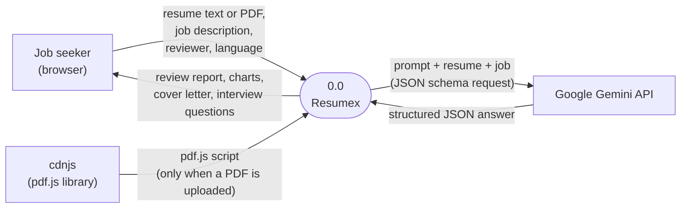
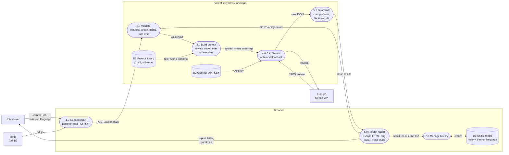
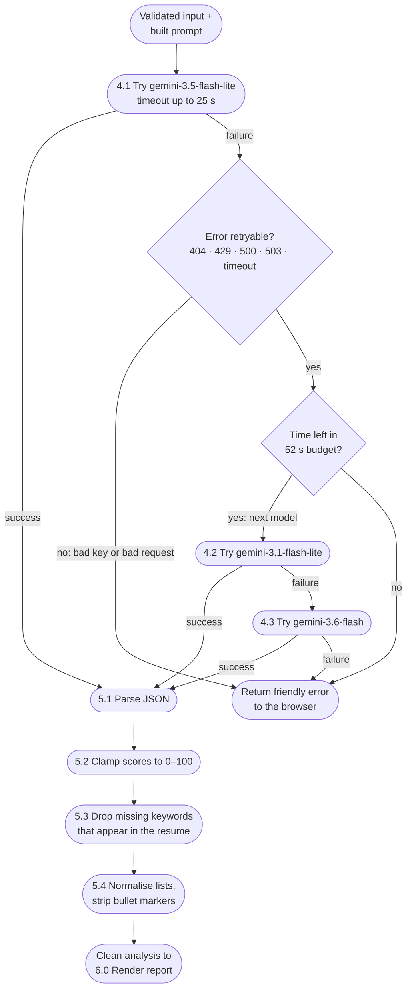
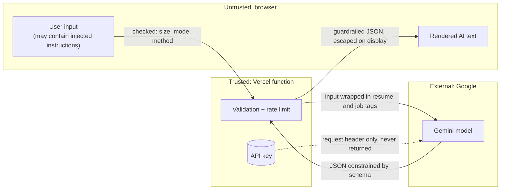
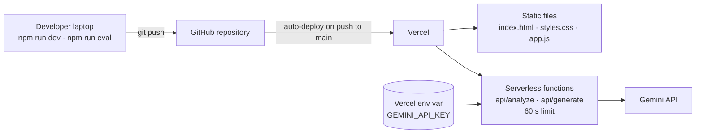

# Resumex — Architecture and Data Flow

This document describes how data moves through Resumex, using data flow diagrams (DFDs) at three levels, then the data stores, trust boundaries and message formats.

**Notation used in the diagrams**

| Shape | Meaning |
|---|---|
| Rectangle | External entity: a person or system outside Resumex |
| Rounded box | Process: something Resumex does to data |
| Cylinder | Data store: where data is kept |
| Labelled arrow | Data flow |
| Shaded box | Trust boundary |

---

## Level 0 — Context diagram

The whole system as one process, with everything it talks to.



---

## Level 1 — Main processes

The same pipeline serves both endpoints: `/api/analyze` for the review, and `/api/generate` for the cover letter and interview prep.



Validation errors from 2.0 (`400`, `429`) and AI failures from 4.0 go straight back to 6.0, which shows them as a friendly message.

| Process | Where it runs | Code |
|---|---|---|
| 1.0 Capture input | Browser | `app.js` → `handleFile`, `pdfToText` |
| 2.0 Validate | Server | `lib/http.js` → `rejectRequest`, `readInput` |
| 3.0 Build prompt | Server | `lib/prompts.js` → `PROMPTS`, `EXTRA_PROMPTS`, `MODES`, `languageRule` |
| 4.0 Call Gemini | Server | `lib/gemini.js` → `runWithFallback`, `callGemini` |
| 5.0 Guardrails | Server | `lib/gemini.js` → `cleanAnalysis`, `cleanExtra` |
| 6.0 Render report | Browser | `app.js` → `renderResults`, `radarChart`, `runTool` |
| 7.0 Manage history | Browser | `app.js` → `saveToHistory`, `renderHistory`, `renderTrend` |

---

## Level 2 — Processes 4.0 and 5.0 in detail

How one analysis request becomes a safe answer, including model fallback.



---

## Data stores

| Store | Location | Contents | Lifetime |
|---|---|---|---|
| D1 `resumex.history.v1` | Browser localStorage | Up to 15 entries: `{id, date, mode, jobTitle, jdKey, score, previous, result}`. `result` holds the analysis only, **never the resume text** | Until the user clears history or browser data |
| D1 `resumex.theme`, `resumex.lang` | Browser localStorage | `"light"`/`"dark"`, `"en"`/`"hi"` | Same |
| D2 `GEMINI_API_KEY` | Vercel environment variable (`.env.local` when local) | The Gemini API key | Server only. Never sent to the browser or committed |
| D3 Prompt library | `lib/prompts.js` | Reviewer roles, prompt versions v1/v2, cover letter and interview prompts, JSON schemas | Versioned in git |

Resumex has **no database**. Resume text exists only in the browser tab and in the single request to Gemini.

---

## Trust boundaries



| Boundary crossing | Risk | Control |
|---|---|---|
| Browser → server | Oversized or malformed input, abuse | 50–20,000 character limits, mode whitelist, POST only, 10 requests/min per IP |
| Server → Gemini | Prompt injection hidden in a resume | Input placed inside `<resume>` / `<job_description>` tags, model told to ignore and flag instructions inside them |
| Server → Gemini | Leaking the API key | Key sent only in the `x-goog-api-key` header from the server, never in a URL or response |
| Gemini → server | Invalid or invented output | `responseSchema` JSON, score clamping, keyword cross-check against the resume, honesty rules in the prompt |
| Server → browser | Script injection through AI text | Every AI string is HTML-escaped before it is inserted into the page |

---

## Message formats

**`POST /api/analyze`** request
```json
{ "resume": "string (50–20,000 chars)", "jobDesc": "string (50–20,000 chars)",
  "mode": "general | tech | fresher | changer", "language": "en | hi" }
```

Response `200`
```json
{
  "analysis": {
    "ats_score": 75,
    "score_breakdown": { "skills": 75, "experience": 80, "keywords": 70, "presentation": 72 },
    "summary": "string",
    "strengths": ["string"],
    "missing_keywords": ["string"],
    "skill_gaps": [{ "skill": "string", "priority": "must-have | nice-to-have", "how_to_close": "string" }],
    "improvements": ["string"],
    "bullet_rewrites": [{ "original": "string", "improved": "string with [placeholders]" }],
    "guardrail_removed": ["keywords the model wrongly called missing"]
  },
  "model": "gemini-3.5-flash-lite", "version": "v2", "mode": "fresher", "language": "en"
}
```

**`POST /api/generate`** request: the same fields plus `"type": "cover_letter" | "interview"`.

Response `200`: `{ "type", "model", "result" }`, where `result` is `{ "subject", "body" }` for a cover letter, or `{ "questions": [{ "question", "category", "why_asked", "how_to_answer" }] }` for interview prep.

Errors: `400` invalid input · `405` wrong method · `429` rate limited or AI busy · `500` key missing · `502` AI failure. Each one returns `{ "error": "message for the user" }`.

---

## Deployment


